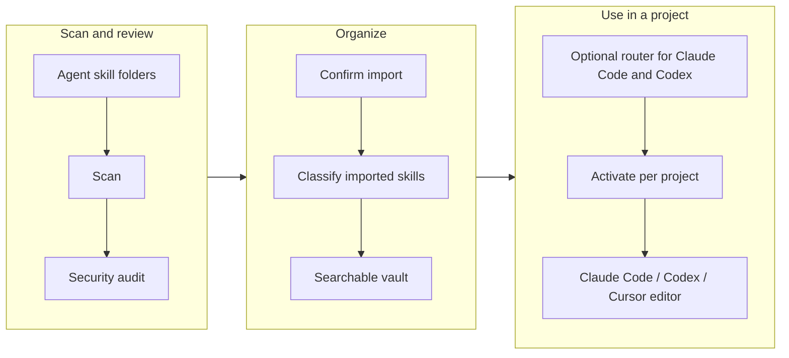
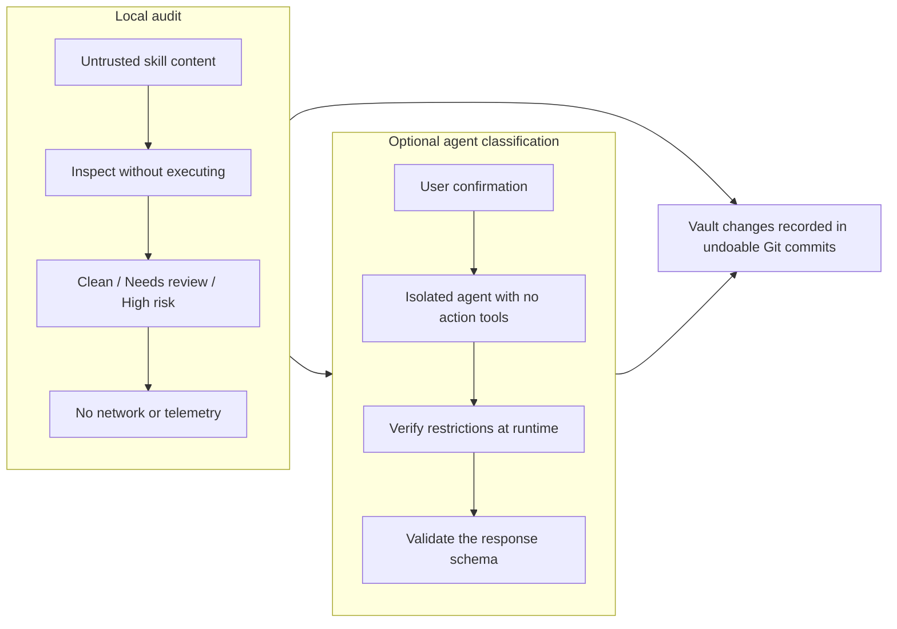
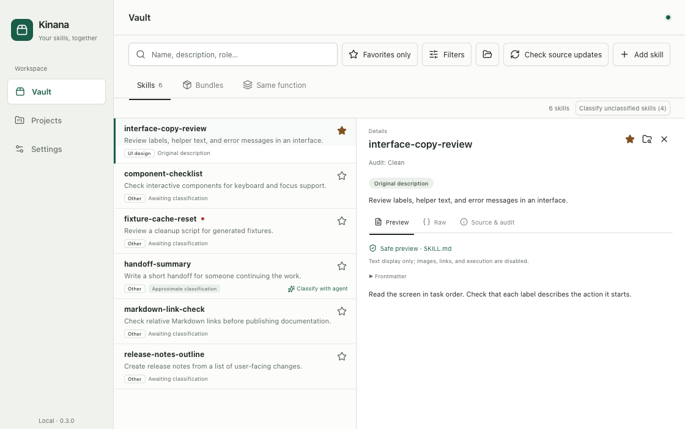
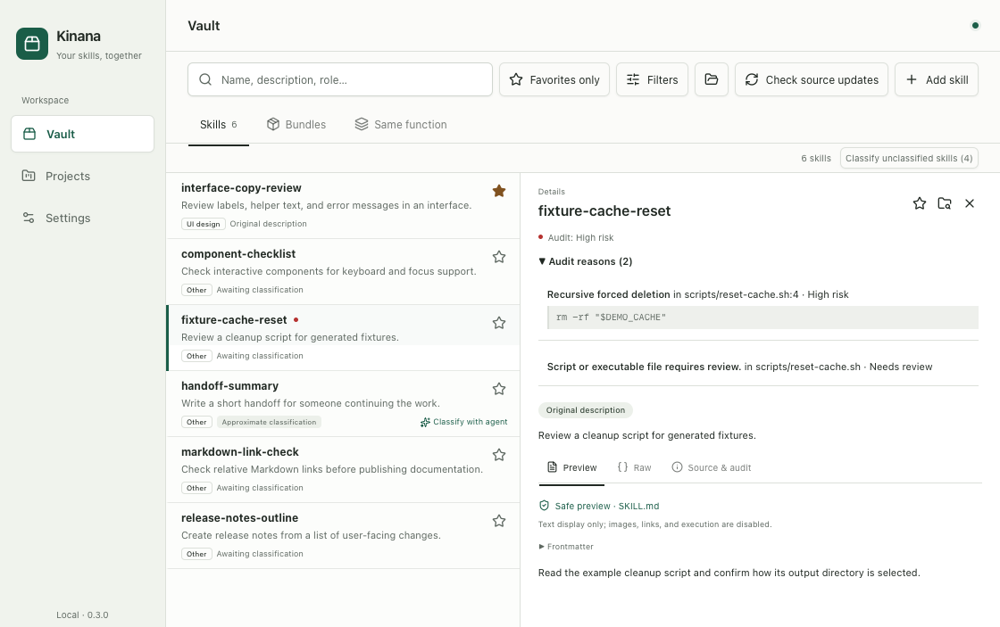
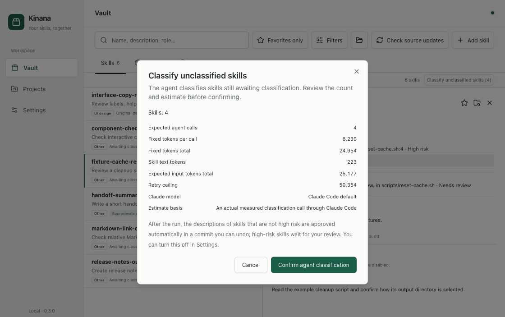
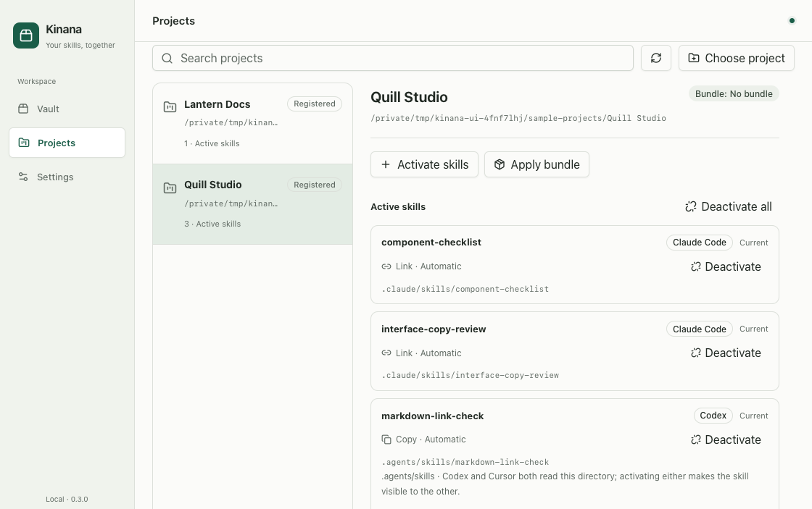

# Kinana

**Kinana — a quiver for your AI agent skills.**

[](https://github.com/khaled1174/kinana/releases/tag/v0.4.0-beta-rc1)
[](#install)
[](LICENSE)
[](RELEASE_NOTES_0.4.0-beta-rc1.md)

## What is Kinana?

Skills tend to pile up across agent folders and project repositories. Kinana brings the ones you choose into a personal vault on your Mac. Scan and audit them in one place, classify them for easier browsing, and activate only the skills a project needs. The name *Kinana* means “quiver.”

## Features

- **Scan and import.** Find skills in known agent folders, review duplicates and competing versions, then choose what to add. When you add a project, you can review and import its local skills without changing the project.
- **Review security findings.** See a risk level and inspect the file, line, and short excerpt behind a finding. Audit excerpts hide detected secret values. Preview imported skill text without running it.
- **Classify with your local agent.** Use Claude Code or opt in to experimental Pi support. Review the model and estimated input before confirming a run. Offline keyword classification is also available.
- **Approve descriptions.** Eligible proposals for clean skills and skills that need review are approved automatically by default. High-risk proposals wait for you. You can turn automatic approval off or approve selected proposals together.
- **Activate by project.** Link skills to the vault or copy them into a project. Save sets as bundles and reuse them across projects. Approve high-risk activations in the app.
- **Use the optional router.** Ask Claude Code or Codex for suggestions from the vault and approve activation when you need it.
- **Undo vault changes.** Git records changes to the vault so you can undo the last one. Use deactivation to remove Kinana-managed links and copies from a project.

## How it works

Agent skill folders feed the scan. Review the audit, bring your selected skills into the vault, and classify them there. Activate skills for a project or use the optional router to ask for suggestions.



## Security model

Kinana treats skill files as untrusted data and audits them without running their contents. Agent classification requires confirmation and runtime evidence that the isolated process stays within its text-only interface, without tools that act on files or run commands. Vault edits have a Git history.



The audit flags patterns worth inspecting. A **Clean** result only means the audit found no signals under its current rules. Read unfamiliar skill instructions before activating them, including any files the skill tells the agent to run.

## Screenshots

Captured in the English desktop app with synthetic skills and projects.

| Vault | Skill details and audit |
| --- | --- |
| [](docs/assets/vault.png) | [](docs/assets/skill-audit.png) |

| Classification preview | Projects |
| --- | --- |
| [](docs/assets/classification.png) | [](docs/assets/projects.png) |

## Install

Kinana requires **Apple Silicon (`arm64`)** and **macOS 27.0 or later**. The signed beta was verified on **macOS 27.2.1**.

1. From the [0.4.0 beta RC1 release page](https://github.com/khaled1174/kinana/releases/tag/v0.4.0-beta-rc1), download `Kinana-0.4.0-beta-rc1-arm64.dmg`, `SHA256.txt`, and `THIRD_PARTY_NOTICES.md`. Keep them together and run `shasum -a 256 -c SHA256.txt` from that folder to verify the downloads.
2. Open the disk image, drag **Kinana.app** to **Applications**, and eject the image.
3. Open Kinana from **Applications**. The beta is Developer ID signed and notarized. macOS may ask you to confirm the first launch of a downloaded app. If it instead reports that the app is damaged or the developer cannot be verified, recheck the download and keep Gatekeeper enabled. [Apple’s Gatekeeper guide](https://support.apple.com/en-us/102445)

## Quick start

1. Open Kinana and create a vault at `~/KinanaVault`, or select an existing vault.
2. Scan your agent skill folders. Read the audit findings and confirm the skills you want to bring into the vault.
3. Choose **Classify unclassified skills**, check the agent and estimate, and confirm. You can use offline keywords or skip this step.
4. Open **Projects**, choose a project, and activate individual skills or apply a bundle. If Kinana finds project-local skills, **Review and add** opens an optional import review.
5. If you want suggestions in Claude Code or Codex, preview and confirm the router installation in **Settings**, then start a new agent session.

## Supported agents

| Agent | Project activation | Classification | Router |
| --- | --- | --- | --- |
| Claude Code | Link or copy | Supported | Supported |
| Codex | Link or copy | Unavailable. Kinana cannot verify that Codex classification disallows local file reads. | Supported |
| Cursor editor | Link or copy | Unavailable | Unavailable |
| Pi | Unavailable | Experimental, off by default. Requires reviewed Pi **1.5.2** or **1.6.1**. | Unavailable |

Codex and the Cursor editor share the project’s `.agents/skills/` directory. Both can see skills activated there.

## CLI

The CLI ships inside `Kinana.app`. These examples use the default vault and the current project directory. The last command previews a pending batch without calling a model.

```sh
KINANA=/Applications/Kinana.app/Contents/MacOS/kinana
"$KINANA" status --project "$PWD"
"$KINANA" suggest --project "$PWD"
"$KINANA" list --brief
"$KINANA" classify --pending --agent claude --dry-run
```

## Privacy

Kinana has no account system or telemetry. Your vault lives in `~/KinanaVault` by default. The audit, search, and keyword classifier run without a network connection. If you approve agent classification, the locally installed Claude Code or Pi uses your existing account or provider subscription and may send skill text and classification context to that provider. Remote imports, source update checks, and Git remote operations use the destinations you choose.

## Known issues

- Some ordinary environment reads may trigger a high-risk finding. Use **Settings → Maintenance → Refresh audit** to see what the current rules change in an existing vault.
- Pi’s local model list may include models your provider does not offer to your account.
- Classification still uses prompt template 1. Choosing a classifier in the scan flow and editing a proposed description before approval are deferred.

[Full 0.4.0 beta RC1 release notes](RELEASE_NOTES_0.4.0-beta-rc1.md)

## Roadmap

- Browse skills by category and see which ones are active across projects.
- Explain why Kinana suggests grouping two skills.
- Let users choose the classifier in the scan flow and edit proposals before approving them.
- Evaluate the next classification prompt and its description guidance against a labeled set.

## License

Kinana is released under the [MIT License](LICENSE). See [Third-party notices](THIRD_PARTY_NOTICES.md) for the bundled dependencies and their licenses.
